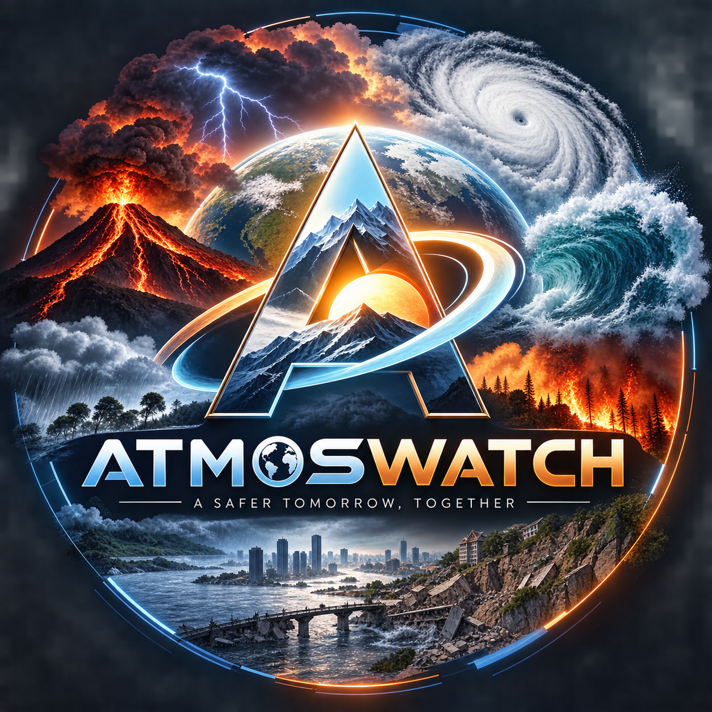

# AtmosWatch

**Disaster Preparedness and Response Education System for Schools and Colleges**

**A Safer Tomorrow, Together.**



AtmosWatch helps learners understand common hazards, practise response decisions, and gives authorized educators a place to organize institution readiness. The platform distinguishes public hazard observations, weather model output, curated learning content, institution-owned records, and educational simulations.

This is a functional educational core. It is not an official warning, emergency dispatch, building certification, or legal compliance system. In a real emergency, follow competent local authorities and the institution's approved plan.

## What works

- Login-first entry flow: `/` sends signed-out visitors to login and signed-in users to their role dashboard; public information remains available without an account.
- Separate, responsive ADMIN, INSTRUCTOR, and STUDENT workspaces with role-specific navigation and dashboards.
- Public About, How It Works, Disaster Guides, Resources, and Data Sources pages; login and student registration are available from the upper-right navigation.
- Student-only public registration, bcrypt password hashing, signed HttpOnly sessions, and secure one-time account activation.
- Three server-enforced roles: `ADMIN`, institution-scoped `INSTRUCTOR`, and personal-record `STUDENT`.
- Admin and instructor user-management pages. Admins manage roles, institution assignments, activation and audit history; instructors create students only in their institution.
- Institution-scoped quiz authoring at `/quizzes`: instructors save drafts, publish to their assigned institution, and review attempts; students receive published questions without answer keys, with scores checked by the API.
- Account role/status/scope changes revoke existing sessions. Sensitive account mutations are written to a read-only administrator audit log.
- Four source-linked learning pathways with lesson progress, server-scored quizzes, and saved scores for signed-in learners.
- Authenticated Disaster Learning Hub at `/learning/disasters`, with 14 detailed hazard pathways, five original animated scenarios per topic (70 total), accessible transcripts, server-checked checkpoints, and per-user persisted lesson/quiz progress.
- Public Disaster Watch at `/disaster-updates`, combining NASA Earth Observatory published photo stories with a separately labeled GDACS event feed, attribution, source links, refresh timestamps, caching, and stale/partial-source states.
- Three branching-style decision practice scenarios with server-scored answers and saved attempts. Scenarios are labelled as simulations and cannot send real alerts.
- Hazard intelligence center with source/type/severity filters, OpenStreetMap map attribution, normalized USGS earthquake and GDACS multi-hazard data, data freshness, and source links.
- Location search, current weather model output, five-day forecast chart, and modelled air-quality context from Open-Meteo.
- Admin-managed institution workspaces and institution-scoped readiness checklist/drill CRUD, with server-side role and tenant checks.
- Student-owned readiness checklist, saved to the student's account; instructor learning summaries are aggregated and scoped to the instructor's institution.
- Searchable official resource library.
- MongoDB models for users, institutions, learning progress, simulation attempts, checklists, and drills.
- Research, architecture, dataset catalog, and privacy documentation.

## Brand assets

The supplied AtmosWatch emblem is preserved as the full-resolution master at `apps/web/public/brand/atmoswatch-logo-master.png`. The shared `BrandLogo` component uses artwork-derived variants for the header and emblem mark. Browser favicon, Apple touch icon, PWA manifest, and Open Graph preview assets are served from `apps/web/public/` and `apps/web/public/brand/`.

## Technology

- React 19, Vite, React Router, Recharts, Leaflet/React Leaflet, Lucide React.
- Node.js, Express 5, MongoDB/Mongoose, Zod, bcryptjs, signed JWT in HttpOnly cookie.
- Vitest/React Testing Library for frontend component and role-routing checks; Node built-in test runner for scoring logic and MongoDB-backed authorization integration tests.

## Requirements

- Node.js 22 LTS recommended and npm 10+.
- MongoDB 7+ for account and institutional persistence. Public education and provider routes can run while MongoDB is offline.

## Setup

From the repository root:

```powershell
npm install
Copy-Item .env.example .env
```

Edit `.env` and set `SESSION_SECRET` to a unique random string with at least 32 characters. Start MongoDB locally or set `MONGODB_URI` to an authorized development database. Keep `.env` private and out of Git.

Public registration creates students only. To bootstrap the first administrator, set `ADMIN_BOOTSTRAP_EMAIL` to an existing active account and run `npm run bootstrap:admin -w @atmoswatch/api -- --confirm`. Promotion is refused when an active administrator already exists. Admins can then create institutions and instructor/student accounts. Managed accounts remain inactive until recipients use the single-use activation link.

The Disaster Learning Hub requires sign-in for all three roles. Public Disaster Watch and official information pages do not require an account. NASA story images are displayed only when the feed includes a caption and uses an approved NASA HTTPS host; review original article credits and third-party rights. ReliefWeb is not queried because it requires a pre-approved `appname`.

For an existing database, first review role mappings with `npm run migrate:roles -w @atmoswatch/api`; apply them with `npm run migrate:roles -w @atmoswatch/api -- --apply`. It updates role fields in place without changing IDs or related records. Back up the database before applying.

Start both apps:

```powershell
npm run dev
```

- Web: `http://localhost:5173`
- API: `http://localhost:5000/api/v1/health`

The API reports MongoDB availability in health output. Registration, saved progress, scenario history, and institution features require a working MongoDB connection.

## Commands

```powershell
npm run dev:web       # Vite client only
npm run dev:api       # Express API only
npm run test          # API domain tests and web component tests
npm run build         # Production web bundle
npm run seed          # Initialize core MongoDB indexes; no privileged or fake users created
npm run migrate:roles -w @atmoswatch/api # Dry run; add -- --apply to migrate existing accounts
npm run bootstrap:admin -w @atmoswatch/api -- --confirm # Bootstrap an existing account if no active admin exists
```

The seed command deliberately creates no default credentials or fabricated institution records. Learning and simulation fixtures are curated educational content in `apps/api/src/data/curriculum.js`, not live disaster data.

## Environment variables

| Variable                |         Required | Purpose                                                                    |
| ----------------------- | ---------------: | -------------------------------------------------------------------------- |
| `NODE_ENV`              |               No | `development` or `production`.                                             |
| `PORT`                  |               No | API port; defaults to 5000.                                                |
| `WEB_ORIGIN`            |               No | Primary allowed browser origin. Defaults to localhost only in development. |
| `ALLOWED_ORIGINS`       |               No | Comma-separated additional trusted web origins.                            |
| `MONGODB_URI`           |  For persistence | MongoDB connection string.                                                 |
| `SESSION_SECRET`        | Yes to start API | Random secret, minimum 32 characters. No insecure default is used.         |
| `COOKIE_SECURE`         |       Production | Set `true` when served over HTTPS.                                         |
| `ADMIN_BOOTSTRAP_EMAIL` |   One-time setup | Existing active account promoted only when there is no active admin.       |
| `FIRMS_MAP_KEY`         |         Optional | Reserved for future NASA FIRMS integration; no FIRMS API call is made yet. |

In development, origin checks also allow only HTTP `localhost` and `127.0.0.1` on Vite ports 5173-5176. Mutating requests require a trusted `Origin`. Production requests must match `WEB_ORIGIN` or an entry in `ALLOWED_ORIGINS`; do not use a wildcard with credentialed cookies.

## Data sources and attribution

- USGS real-time GeoJSON earthquake feed and event details.
- GDACS search API for global multi-hazard events. Acknowledge “Global Disaster Awareness and Coordination System, GDACS” and review its current terms/disclaimer before deployment.
- Open-Meteo forecast and air-quality endpoints. Models, coverage, and update timing vary; review current provider terms, attribution, and commercial-use requirements before deployment.
- OpenStreetMap map tiles with visible OpenStreetMap contributor attribution.
- India school safety, NIDM, UNDRR, and NDMA SACHET links in the resource library.

NASA FIRMS requires a MAP key and Earthdata access for some services. The UI reports this requirement and does not show fabricated fire detections. No historical bulk dataset is bundled; see [datasets/catalog.json](datasets/catalog.json), [docs/DATA_CATALOG.md](docs/DATA_CATALOG.md), and [docs/RESEARCH.md](docs/RESEARCH.md).

## Security and privacy

Passwords are hashed. Browser session tokens are HttpOnly cookies with SameSite=Strict. The browser does not keep authentication tokens in localStorage. API request bodies are validated, auth endpoints are rate-limited, mutation origins are checked, and institution records are scoped by the authenticated user's server-loaded institution ID. No exact browser geolocation is collected. Read [docs/PRIVACY.md](docs/PRIVACY.md).

This is not a compliance certification. Before use with students, review consent/notice, retention and deletion, account recovery, backups, institution membership administration, and jurisdiction-specific child privacy requirements. Avoid storing unnecessary identifiable student or sensitive campus security data.

## Known limitations

- Institution membership is currently a single institution reference on a user. Class/group assignments, self-service profile editing, and profile-image uploads are not implemented. Student and educator access is currently scoped at the institution level.
- Instructor quiz authoring and results are implemented; institution-specific module/article authoring and publishing, notifications, student-submitted incident reports/evidence, corrective actions, resource inventory, campus map editing, PDF/CSV reporting, and scheduled ingestion are not implemented.
- Disaster curriculum editing/publishing and external video embedding are not implemented. The 70 scenario lessons are original AtmosWatch animations; external video count is zero because individual videos were not independently verified for availability, captions, and embedding/reuse conditions. See [docs/DISASTER_EDUCATION_RESEARCH.md](docs/DISASTER_EDUCATION_RESEARCH.md).
- Public disaster stories currently use NASA Earth Observatory RSS; current event metadata uses GDACS. ReliefWeb and state-authority article/photo ingestion are not configured. Stories may be empty or partially unavailable when sources publish no matching story or an upstream provider is down.
- GDACS fetches one page (up to 100 records) from the last 30 days. It is a global context source, not a local authority warning feed.
- NASA FIRMS is catalogued but not connected; India SACHET is linked, not ingested programmatically.
- Open-Meteo air-quality values are model output. The displayed European AQI field is not an India-specific health standard.
- Session cookies do not yet have a persisted revocation store or refresh-token rotation. Rotating `SESSION_SECRET` invalidates active sessions.
- Automated tests cover scoring, shared UI primitives, role routing, the 14-topic/70-scenario catalog, feed metadata normalization, and MongoDB-backed role/scope authorization. No browser end-to-end suite is included yet.
- Current provider availability, terms, and content updates should be rechecked before each deployment. Research limitations are recorded in `docs/RESEARCH.md`.

## Deployment

Build the client with `npm run build`; deploy `apps/web/dist` to a static host and run `apps/api` as a Node service with a managed MongoDB database. Configure `WEB_ORIGIN`, optional `ALLOWED_ORIGINS`, `MONGODB_URI`, a strong `SESSION_SECRET`, and `COOKIE_SECURE=true` over HTTPS. Configure reverse proxy/API routing for `/api/v1`, HTTPS, database backups, logs that avoid sensitive fields, and provider usage review. Do not deploy the educator invite code in public client configuration.

## License

No `LICENSE` file was present in the source repository. No license is asserted here; the maintainers should confirm project ownership and add the intended license before redistribution.
